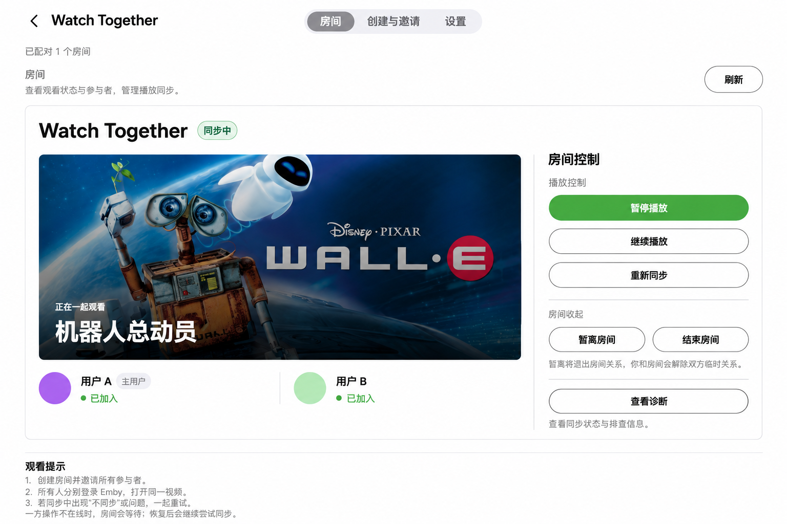

# Emby Watch Together

让同一台 Emby Server 上的两个人一起观看：创建房间，打开同一视频，由服务器协调播放状态和进度。插件运行在 Emby Server 内，无需额外同步服务。

[安装](#安装) · [开始使用](#开始一起观看) · [兼容性与帮助](#兼容性与帮助) · [开发者文档](docs/README.md)

*基于用户截图经 AI 脱敏及示意处理，部分界面文字与实际产品不同，并非原始截图；操作以本文说明及实际界面为准。电影素材权利与来源见[图像说明](docs/images/README.md)。*

## 选择版本

| 通道 | 当前版本 | 适合谁 |
| --- | --- | --- |
| 正式版 | [v1.7.1.0](https://github.com/hope140/EmbyWatchTogether/releases/tag/v1.7.1.0) · [说明](docs/releases/v1.7.1.0.md) | 希望使用 stable 版本的用户 |
| 测试版 | [v1.7.2.5](https://github.com/hope140/EmbyWatchTogether/releases/tag/v1.7.2.5) · [说明](docs/releases/v1.7.2.5.md) | 愿意测试最新改进的用户 |

v1.7.2 系列的真实双端播放验收仍待执行；自动化回归不能替代实机验收。查看[全部版本说明](docs/releases/README.md)。

## 能做什么

- 管理员创建双人房间并指定主用户；普通用户也可以通过一次性邀请码创建自助房间。
- 双方打开同一视频后，插件协调暂停、定位和继续播放；观看期间同步明确的暂停、继续和明显拖动。
- 主用户换片时，插件尝试让另一方打开相同视频，再重新对齐；参与者自行换片不会让主用户跟随。短暂掉线和明显漂移有有限的恢复机制，插件不会为小幅差异连续追赶跳转。
- 在房间页查看状态、控制房间及导出脱敏诊断；管理员可调整提示、停止行为和更新通道。

## 安装

1. 从 [Latest stable Release](https://github.com/hope140/EmbyWatchTogether/releases/latest) 下载 `EmbyWatchTogether.zip`。如需测试版，请从[测试版 Release](https://github.com/hope140/EmbyWatchTogether/releases/tag/v1.7.2.5) 下载。
2. 停止 Emby Server，解压并将 `Emby.Plugins.WatchTogether.dll` 直接放入 Emby Server 数据目录的 `plugins` 目录，不要再套一层子目录。
3. 启动 Emby Server，在 **Dashboard → Plugins → Watch Together** 确认插件及设置页可用。

升级前建议备份旧 DLL，方便回滚。安装包为单 DLL，无需复制源码或运行旁车进程。

## 开始一起观看

在 Emby 用户菜单打开 **Watch Together**。管理员可以使用三个页面：

| 页面 | 用途 |
| --- | --- |
| 房间 | 查看状态，加入或暂离房间，控制播放、重新同步和查看诊断。 |
| 创建与邀请 | 指定两名用户和主用户创建房间，或创建、接受邀请码。 |
| 设置 | 调整播放停止行为、文字提示和更新通道。 |

普通用户可访问“房间”和“邀请”页面。管理员也可从插件配置页进入。

1. 管理员在“创建与邀请”中创建房间；或者一人创建邀请码并立即发送给另一位用户，对方在“邀请”中接受。
2. 两人登录同一台服务器，在各自客户端打开同一视频；如有需要，在房间页点击“加入房间”。
3. 等待状态刷新和同步完成，之后即可一起观看。暂停、继续或拖动时，请给客户端和服务器一点时间处理。

邀请码有效 15 分钟，只能接受一次；服务器重启后未接受的邀请码失效。“暂离房间”保留成员关系，之后可重新加入；“结束房间”解除双方关系，不删除媒体。

## 设置与更新

管理员可在“设置”中控制停止时暂停另一方、停止提示和同步操作提示，默认均开启。设置保存后在下一轮同步中生效。

Emby 的 **Dashboard → 计划任务 → Watch Together → Update Plugin** 可调整时间、禁用或手动执行更新；其中 Watch Together 是任务分类，Update Plugin 是任务名称。`stable` 通道使用 GitHub Latest；`beta` 从公开、非 draft 的 stable 和 prerelease 中选择最高规范版本。安装前会校验签名、大小、哈希、程序集名称和版本，安装成功后按提示重启 Emby。可选 GitHub Token 用于 beta 的 Releases API 查询，页面不回显 Token，匿名查询也可使用。

## 兼容性与帮助

- 一个房间恰好两人，双方须登录同一台 Emby Server；不支持多人房间或跨服务器同步。
- 插件按 Emby Server 4.9 API 构建。客户端需要支持暂停、继续和进度拖动等远程控制，双方应使用 1 倍速播放；同步依赖服务器会话快照，不保证逐帧一致。具体证据和未完成的验收见[客户端兼容性记录](docs/client-compatibility.md)。
- 一直等待时，请确认双方已加入、在线且打开同一视频，并检查客户端远控能力。状态更新可能需要一轮刷新；必要时可在房间页重新同步。
- 排查时可导出脱敏诊断 JSON，并提供操作时间、双方客户端及版本、房间状态和预期与实际结果。不要公开 Token 或完整服务器日志。

开发者和维护者请从[文档索引](docs/README.md)进入，构建、API 和排错细节见[技术文档](docs/technical.md)。

项目按 [Apache License 2.0](LICENSE) 许可；文档图片的来源与许可见[图像说明](docs/images/README.md)。
